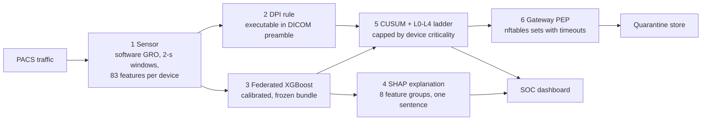

# VitalGate

**A federated, explainable, AI-driven framework for real-time intrusion detection and zero-trust isolation in DICOM medical-imaging networks.**

VitalGate watches the traffic of a hospital's PACS (picture archive), detects attacks on the DICOM protocol in about 2 to 5 seconds, explains every alert in plain words, and contains the attacking device with a graded zero-trust response that never cuts a scanner off from its archive. Hospitals train the detector together with federated learning, without sharing any traffic.

---

## Why

DICOM was designed for trusted hospital networks: the AE title is often the only credential, traffic is usually unencrypted, and imaging devices can rarely be patched. Generic intrusion detection does not understand DICOM, black-box alerts are hard to trust, blocking a scanner mid-exam harms patients, and hospitals cannot pool their traffic to train a better model.

## How it works



| Layer | What it does |
| --- | --- |
| 1 Sensor | Captures packets to and from the PACS (first 512 bytes: headers, no images), rebuilds the packet view training saw (software GRO), cuts traffic into 2-second windows per device and computes 83 features: 27 network and DICOM features, their values in the device's two previous windows, and time gaps. |
| 2 Rules | Flags any uploaded DICOM file whose preamble holds an executable (polyglot files). |
| 3 Model | XGBoost trained with **FedXgbBagging** across three hospitals (equal 1/n scaling), every update checked by a **k-of-n peer-validation gate** against poisoning; temperature-calibrated. |
| 4 Explainability | Exact TreeSHAP for the federated ensemble, grouped into 8 readable evidence groups; each alert gets "what happened, what VitalGate did, what to check". |
| 5 Response | CUSUM per device turns window scores into alarms; the ladder picks L0 allow, L1 watch, L2 restrict, L3 quarantine or L4 isolate from severity x confidence x duration. The PACS is never taken past L2 and scanners never past L3 automatically. |
| 6 Enforcement | A gateway agent applies each level as nftables set entries with a kernel timeout: every action expires on its own unless renewed (**fail-open**). L3 sends a device's DICOM uploads to a quarantine store, which releases them to the PACS after checking. |

## Results

**Lab (Vitalgate dataset, 51,733 windows, 3 sites, split by attack run)**

| Measure | Result |
| --- | --- |
| Federated vs centralised macro-F1 | 0.955 vs 0.958 (single sites 0.927-0.949; unseen site 0.948) |
| One dishonest hospital, k-of-n gate | worst case 0.949 vs 0.953 clean; 76-97 % of malicious updates rejected, 0 % of honest ones |
| Detection (CUSUM) | 126/126 attack runs, median 4 s, 0.027 false episodes per host-hour |
| Clinical traffic blocked, ladder vs binary blocking | 0 vs 0.10 min per host-hour |

**Independent test bed (new PACS, DCMTK clients, real-size images, network noise, 17 attack variants of which 10 are novel; model frozen)**

| Measure | Result |
| --- | --- |
| Attacks detected, final campaign | 16/17 (9/10 novel), median 3.5 s |
| Clinical traffic blocked, ladder vs binary | 0 vs 0.21 min per host-hour |
| False actions per host-hour: frozen / per-hospital local model + onboarding | 1.44 / 0.24 |
| Live quarantine of a compromised CT | quarantined in 9.3 s; its 5 new images uploaded successfully during quarantine, held, then released and found in the PACS (5/5); its other access blocked |

Full write-up, including limitations: [VitalGate: Test-Bed Evaluation and Results](https://claude.ai/artifact/SbZ7fMnQNiFHduWJdJeBSe).

## Repository layout

```
eda.ipynb, 02_baseline.ipynb ... 06_zero_trust_response.ipynb   research notebooks (see below)
src/                  feature builder (features.py) and MLflow tracking helper
scripts/              DICOM command extraction, MLflow backfill, notebook upgrades
data/processed/       window table + feature schema + host roles (not in git)
models/, reports/     trained models and notebook reports (models not in git)
product/
  vitalgate/          the product: sensor/, model/, explain/, response/, pipeline.py, evaluation.py
  bundle/             frozen deployed model (48 federated updates, SHA-256 checked); bundle_* = adapted variants
  scripts/            freeze_bundle.py
  tests/              parity tests: sensor vs training extractor, product vs notebooks 05/06
  eval/               offline_eval.py (score a campaign) and results/
  adapt/              fed_adapt.py (federated and personalised adaptation of a new hospital)
  soc/                SOC dashboard: server.py, live.py (live pipeline + controller), replay.py, static/
  testbed/            Docker test bed: PACS, quarantine store, 5 modalities, 2 workstations, monitor,
                      attacker, capture, PEP agent (pep/), orchestrator/ (campaign, demo, enforcement_test)
```

| Notebook | Purpose |
| --- | --- |
| eda | Data checks, window table (windows_v2), feature schema |
| 02_baseline | Baselines vs XGBoost, smoothing, SHAP, robustness splits, local vs centralised |
| 03_federated | FedXgbBagging / cyclic, Dirichlet label skew, unseen site, FedAvg MLP |
| 04_fl_robustness | Poisoning attacks vs clipping, median gate and k-of-n gate |
| 05_explainability | Federated SHAP, class signatures, faithfulness (deletion test), model agreement |
| 06_zero_trust_response | Calibration, CUSUM, L0-L4 ladder vs binary blocking, NIST SP 800-207 mapping |

Files ending in `.v2` / `.v3` are other iterations of the same notebooks, kept for reference; `dl_model_testing.ipynb` holds deep-learning experiments.

## Getting started

Requirements: Python 3.11+ (developed on 3.13), Docker Desktop for the test bed. The product itself needs only `numpy`; the notebooks need `requirements.txt` plus `mlflow`.

```bash
pip install -r requirements.txt mlflow
```

**Research notebooks.** The training data comes from the separate `dicom-lab` capture lab (`out/features_v2.csv`, converted to `data/processed/windows_v2.parquet` by `eda.ipynb`). Run `eda`, then `02` to `06` in order; models land in `models/`, reports in `reports/`.

**Freeze and verify the product** (from `product/`):

```bash
python scripts/freeze_bundle.py                       # copy the trained model into bundle/ with hashes
python tests/test_model_parity.py --features ../../dicom-lab/out/features_v2.csv --hosts ../data/processed/hosts.csv
```

**Test bed** (from `product/testbed/`):

```bash
docker compose up -d --build                          # PACS, quarantine store, devices, capture, PEP agent
python orchestrator/campaign.py --rounds 1 --run-id tb_0001
```

**Evaluate a campaign** (from `product/`):

```bash
python eval/offline_eval.py --pcap-dir testbed/out/pcap --truth testbed/out/truth.csv --run-id tb_0001 --out eval/results/tb_0001
```

**SOC dashboard** (from `product/`, then open http://localhost:8090 and sign in; the first start asks you to create an account, and `python soc/server.py --add-user NAME` adds more):

```bash
python soc/server.py
python soc/live.py                                    # live: follows the capture and drives the gateway
python soc/replay.py --speed 30                       # or: replay recorded traffic without Docker
```

**Live enforcement test and demo** (from `product/testbed/`, test bed running, no other `live.py`):

```bash
python orchestrator/enforcement_test.py               # isolation, quarantine, fail-open -> out/enforcement/report.md
python orchestrator/demo.py                           # 7-minute scripted attack story for a recording
```

## Limitations

- Synthetic hospitals on one machine; one test-bed site; no real vendor devices.
- DICOM features need plaintext DICOM (no TLS).
- Training captures kept 512 bytes per packet, so one feature (DICOM data-message count) depends on how the sending software writes.
- Association floods and P-DATA fuzzing are not reliably detected yet.
- The k-of-n gate cannot tell a hospital whose data differs from a poisoned one; adaptation to a new hospital works locally (personalised model), not through the shared model.
- Dashboard sign-in runs over plain HTTP (no TLS) and has no roles; it serves on localhost only by default.
- IPv4 only; IPv6 traffic is not inspected.

## Author

Areej ([@Areejrashid1](https://github.com/Areejrashid1)), NETSOL IDS research project.
