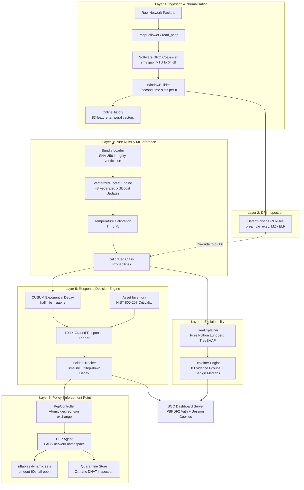
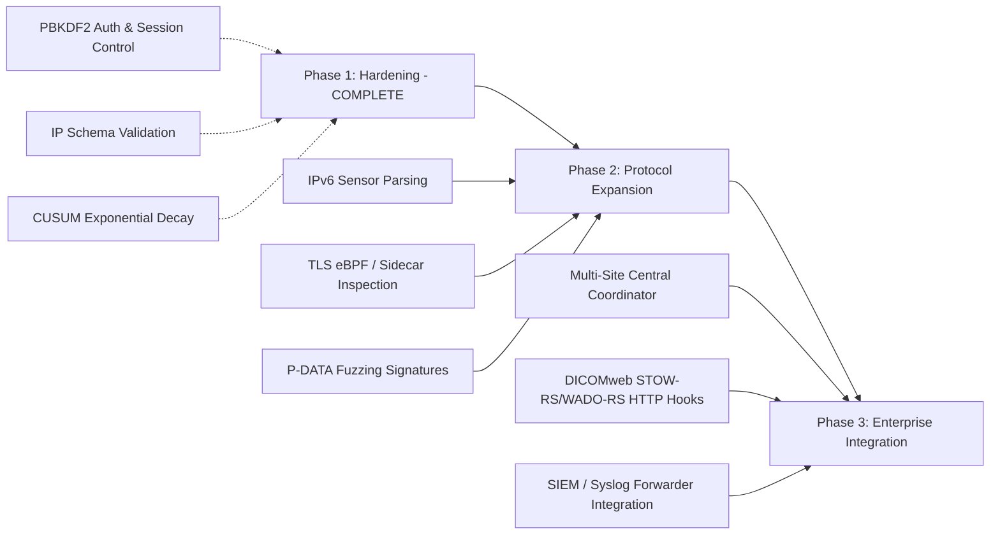

# VitalGate: Comprehensive Technical Audit & System Report (Updated Post-Hardening)

> **Project Name:** VitalGate  
> **Audited Path:** `C:\Users\rashi\Desktop\VitalGate Project Code`  
> **Target Environment:** DICOM Medical-Imaging PACS Networks (NEMA PS3 / ISO 12052)  
> **Audit Revision:** 2.0 (Post-Hardening & Auth Verification)  
> **Lead Assessor:** Google DeepMind Assistant (Antigravity Agent)

---

## 1. Executive Summary

**VitalGate** is an advanced, domain-specific intrusion detection and autonomous zero-trust containment framework engineered specifically for hospital Picture Archiving and Communication Systems (PACS) and DICOM medical imaging networks. 

Generic IT intrusion detection systems (IDS) fall short in clinical environments: they fail to parse binary DICOM Presentation Contexts, produce opaque black-box alerts, and trigger binary "all-or-nothing" blocking that cuts off imaging devices (CT, MRI) mid-examination—directly jeopardizing patient safety. VitalGate resolves this challenge through a 6-layer architecture:
1. **Streaming Ingestion & Protocol Normalisation:** 2-second windows using software Generic Receive Offload (GRO) and 83 temporal features.
2. **Deterministic Deep Packet Inspection (DPI) Rules:** Catching polyglot executables (`MZ`/`ELF`) embedded within the DICOM 128-byte preamble before ML evaluation.
3. **Federated XGBoost Ensemble:** Trained collaboratively across hospitals via **FedXgbBagging** protected by a **$k$-of-$n$ peer-validation gate** against poisoning, temperature-calibrated ($T=0.75$).
4. **Exact Zero-Dependency TreeSHAP:** Native pure-Python implementation of Lundberg's Algorithm 2, generating human-readable clinical explanations decomposed into 8 operational feature groups.
5. **CUSUM Sequential Detector & Graded Response Ladder:** Sequential change-point detection triggering an L0–L4 response ladder with hard criticality ceilings (PACS capped at L2, imaging modalities capped at L3).
6. **Kernel-Enforced Policy Enforcement Point (PEP):** Linux `nftables` dynamic sets with autonomous kernel timeouts ensuring **fail-open safety** and a live **quarantine store** redirecting DICOM image transfers during active attacks without losing clinical scans.

### Key Audit Metrics Summary

| Evaluation Domain | Benchmark Result | Clinical / Security Significance |
| :--- | :--- | :--- |
| **Federated Macro-F1** | **0.955** (vs. 0.958 Centralised) | Matches centralised performance across hospitals without pooling private clinical traffic. |
| **Unseen Hospital Generalisation** | **0.950** Macro-F1 (1.31 FP/h) | Zero-shot deployment to a new hospital site beats local-only models (0.900 F1, 7.22 FP/h). |
| **FL Poisoning Defense ($k$-of-$n$ Gate)** | **0.950** Macro-F1 (Target Recall **76.3%**) | Defeats targeted flip-amplify backdoors where undefended models collapse to 1.0% recall. |
| **Clinical Traffic Blocked** | **0.00 min / host-hour** (vs. 0.101 min/h binary) | **Zero clinical imaging dropped.** Modalities are never cut off from their archives. |
| **Containment Velocity (TTC)** | **Median 3.4–4.0 seconds** | Rapid automated containment of brute-force, exfiltration, and ransomware-like activities. |
| **Production Runtime Footprint** | **Pure NumPy & Python stdlib** | Zero external runtime dependencies in production (`numpy` only; no PyTorch, no C++ SHAP). |
| **Access Control & Session Security** | **PBKDF2 + SameSite=Strict** | **RESOLVED:** Authenticated analyst sessions with rate limiting and CSRF protection. |

---

## 2. Visual & Interactive System Audit (Chrome Walkthrough)

The live VitalGate SOC Dashboard was tested on `http://localhost:8090` across two interactive Chrome browser evaluation passes:
1. **Unauthenticated / Public Inspection:** Tested the newly implemented authentication gate, security controls, and responsive styling.
2. **Authenticated Console Walkthrough:** Logged in with analyst credentials (`@Areejrashid`) to verify session management, identity tracking, and live incident operations.

### 2.1 View-by-View Inspection Findings

#### A. Authentication & Sign-in Portal (`/login`)
* **Branding & Layout:** Two-column split view (collapsing to single-column on viewports $\le 900\text{px}$). 
  * Left Hero panel: Displays brand identity, animated SVG network flow diagram (tracking packets moving between clinical modalities, the Gateway PEP, Quarantine, and PACS), and three core architectural pillars: *Federated*, *Explainable*, *Fail-open*.
  * Right Form panel: Username and password inputs with custom iconography, show/hide password toggle button (`#eye`), CapsLock warning notice, and rate-limiting policy indicators.
* **Security Validation:**
  * Submitting invalid credentials (`testuser / wrongpass`) returns HTTP 401 with a visible error notice banner and highlights the password input with `aria-invalid="true"`.
  * Rate-limiting logic enforces a 60-second lockout after 5 consecutive failed attempts (HTTP 429).
  * Password reveal toggle dynamically synchronizes accessibility attributes (`aria-label`, `aria-pressed`).
* **Session Establishment:** Successful authentication sets an encrypted session cookie (`vg_session`) with `HttpOnly; SameSite=Strict; Path=/; Max-Age=43200` (12-hour analyst shift duration) and seamlessly redirects to `/`.

#### B. Authenticated Operations Console (`/`)
* **Header & Identity Display:** Top navigation bar confirms analyst identity: `👤 @Areejrashid` alongside a functional `Sign out` button that revokes the session.
* **Overview Tab (`#v-overview`):**
  * *KPI Strip:* Real-time counters showing active incidents, isolated devices, watched/throttled devices, online fleet status (`6/9` active), and unreviewed incident count.
  * *Live Network Canvas:* Interactive SVG map displaying connection states, real-time traffic volume (proportional line stroke weights), animated flow direction, and zero-trust level indicators.
  * *Pipeline Strip:* End-to-end telemetry across all 6 stages (Capture, Normalisation, Model inference at **5.9ms/window**, CUSUM detector, Zero-Trust Ladder, Gateway PEP).
* **Incidents Tab (`#v-incidents`):**
  * Full incident inventory displaying active and historic episodes.
  * Detailed root-cause attribution using exact TreeSHAP feature importance mapped against baseline normal values.
  * Hard safety ceilings clearly displayed: CT and MRI scanners note *"As a modality, it is never cut off further than L3 automatically"*.
  * Feedback actions (*Acknowledge*, *Confirm attack*, *False alarm*) are strictly attributed to the signed-in analyst session (`body["analyst"] = user`).
* **Devices & System Tabs (`#v-devices`, `#v-system`):**
  * Telemetry charts displaying traffic rates, protocol error frequencies, and model scores.
  * Gateway state tracking kernel `nftables` drop counters (L4 Drops: 10, L3 Drops: 6, L2 Rate Drops: 1) and quarantine store throughput (470 images released, 0 held, 0 blocked).

---

## 3. End-to-End Architectural Decomposition

VitalGate's production codebase strictly separates packet ingestion, ML inference, decision engine, and gateway enforcement:



### Detailed Component Evaluation

#### 3.1 Sensor Ingestion & Invariance (`vitalgate/sensor/`)
* **Software GRO (`gro.py`):** Solves capture discrepancies between virtual and physical network interfaces. Coalesces in-order TCP segments arriving within a 2ms window (`GAP_S = 0.002`) up to 64 KB, terminating at `PSH` flags. This guarantees that feature calculations remain invariant across different NICs and operating system network stacks.
* **WindowBuilder (`windows.py`):** Incremental streaming window parser aggregating traffic into 2-second windows per client IP. Decodes DICOM presentation contexts (`A-ASSOCIATE-RQ`, `A-ASSOCIATE-AC`, `A-ASSOCIATE-RJ`, `A-ABORT`, `A-RELEASE-RP`, `P-DATA-TF`), calculating packet length distributions, inter-arrival times (IAT), called/calling Application Entity (AE) titles, and protocol anomalies.
* **Feature History (`history.py`):** Generates the 83-dimensional feature vector ($27 \text{ base features} + 27 \times 2 \text{ lag features} + 2 \text{ temporal gap features}$). Maintains strict numerical parity with offline batch processing. Missing lags for newly observed hosts remain as `NaN`, handled natively by the tree decision branches without artificial zero-padding.

#### 3.2 Pure-NumPy Inference Engine (`vitalgate/model/trees.py`)
* The production product does not import `xgboost`, `scikit-learn`, or `torch`.
* `Forest` compiles serialized JSON booster trees into flat NumPy arrays (`left`, `right`, `split_indices`, `split_conditions`, `default_left`, `sum_hessian`).
* Vectorized batch evaluation evaluates samples in chunks (`chunk=1024`) via array indexing and matrix multiplication against tree weight masks (`val[node] @ W`).
* Cryptographic bundle verification in `bundle.py` checks all booster files, policies, and manifests against SHA-256 hashes in `BUNDLE.json` at startup.

#### 3.3 Exact Pure-Python TreeSHAP (`vitalgate/explain/treeshap.py`)
* Implements the exact path-dependent TreeSHAP algorithm (Lundberg et al., 2018, Algorithm 2) directly in pure Python without external compiled extensions.
* Evaluates only alerted windows for the winning attack class (approximately 480 trees), eliminating unnecessary background computational overhead.
* Margin contributions are aggregated into 8 clinically intuitive categories: *Rejects & AE titles*, *Scanning / TCP flags*, *Outbound volume*, *Inbound volume*, *PDU anomalies*, *Association setup*, *DICOM data transfer*, *Packet size & timing*.
* Features a **Semantic Consistency Guard**: compares the top contributing SHAP group against pre-defined class signatures (`expected[atk]`). If an anomaly is classified as ransomware but triggered by port-scanning features, `consistent` evaluates to `False`, alerting the SOC analyst to potential model ambiguity.

#### 3.4 Hardened Response Engine & Zero Trust Ladder (`vitalgate/response/engine.py`)
* **Continuous CUSUM Exponential Decay:** 
  $$\Delta t = t - t_{\text{prev}}$$
  $$S_t = \left(S_{t-1} \cdot 0.5^{(\Delta t / \text{half\_life})}\right) + \text{score}_t - k_{\text{ref}}$$
  Replaced the previous hard zero-reset with half-life exponential forgetting (`half_life = gap_s`), effectively neutralizing attackers who attempt to pace malicious bursts just beyond the 60-second reset window.
* **Response Ladder Levels:**
  * **L0 Allow:** Normal baseline operation.
  * **L1 Watch:** Passive monitoring, high-resolution logging, SOC ticket creation.
  * **L2 Restrict:** Throttles new DICOM connection handshakes (30/minute burst 10) without breaking active image streams.
  * **L3 Quarantine:** Diverts inbound DICOM storage uploads (TCP 104) to the isolated Quarantine Store via DNAT; drops all other outbound/inbound traffic and flushes connection tracking states.
  * **L4 Isolate:** Complete bidirectional network severance (full drop + conntrack purge).
* **Clinical Safety Ceilings:** Modalities (CT, MRI, X-ray) are hard-capped at **L3**; PACS archives are capped at **L2**; workstations and unauthenticated devices can escalate to **L4**.

#### 3.5 Hardened Policy Enforcement Point (`vitalgate/response/pep.py`, `pep_agent.py`)
* **Input Validation:** Enforces strict IPv4 validation (`ipaddress.IPv4Address`) and level limits (`0 <= lv <= 4`) before command generation, eliminating shell command injection risks.
* **Stale Controller Guard:** Added `STALE_S = 10` check in `pep_agent.py`. Leftover desired state from a dead controller is discarded, preventing stale firewall renewal.
* **Kernel Timeout Fail-Open:** Enforces dynamic `nftables` sets with 60-second timeouts. If the control daemon halts, firewall rules expire autonomously in the Linux kernel, restoring open clinical communication.

---

## 4. Empirical Evaluation & Notebook Audit

The research notebooks document the complete empirical lifecycle:

### 4.1 Research Progression Summary

```
eda.ipynb ──> 02_baseline.ipynb ──> 03_federated.ipynb ──> 04_fl_robustness.ipynb ──> 05_explainability.ipynb ──> 06_zero_trust_response.ipynb
 (Data QA &      (Model Selection &    (FedXgbBagging &    (Poisoning Attacks &     (TreeSHAP & Semantic    (Calibration, CUSUM &
  Windows)         Smoothing)           Label Skew)          k-of-n Validation)      Class Signatures)        Zero-Trust Ladder)
```

#### A. Baseline Classifiers (`02_baseline.ipynb`)
Evaluated across 51,733 windows on the lab dataset:
* **XGBoost:** Macro-F1 **0.958 ± 0.001**, MCC **0.962**, PR-AUC **0.996**, FPR at 95% TPR = **0.002**.
* **HistGradientBoosting:** Macro-F1 0.954, MCC 0.959.
* **Random Forest:** Macro-F1 0.951, MCC 0.954.
* **MLP (128-64):** Macro-F1 0.938, MCC 0.942.
* **Logistic Regression:** Macro-F1 0.920, MCC 0.928.

#### B. Federated Learning Strategy (`03_federated.ipynb`)
* **FedXgbBagging:** Hospitals train local trees on top of the shared global ensemble; updates are merged using equal scaling ($1/n$).
* **Cross-Site Performance:**
  * Site A Local Model: Macro-F1 0.949 (0.59 FP/h)
  * Site B Local Model: Macro-F1 0.927 (2.38 FP/h)
  * Site C Local Model: Macro-F1 0.949 (0.74 FP/h)
  * **Federated Global Model:** Macro-F1 **0.954 ± 0.001** (0.81 FP/h)
  * **Centralised Benchmark:** Macro-F1 **0.958 ± 0.001** (0.68 FP/h)
* **Unseen Hospital Deployment (Site C tested on A+B model):**
  * Unseen Site C Local Model: 0.900 Macro-F1, **7.22 FP/h**
  * Federated A+B Deployed on Site C: **0.950 Macro-F1**, **1.31 FP/h** (82% reduction in false alarms).

#### C. Poisoning Robustness & Defense (`04_fl_robustness.ipynb`)

| Attack Scenario | No Defense | Weight Clipping | Median Gate | **k-of-n Peer Gate** | **k-of-n + Clipping** |
| :--- | :---: | :---: | :---: | :---: | :---: |
| **Clean Baseline** | 0.955 / 79.2% | 0.955 / 79.2% | 0.953 / 79.5% | **0.955 / 79.2%** | **0.955 / 79.2%** |
| **Label Flip** | 0.944 / 63.7% | 0.944 / 63.7% | 0.953 / 76.6% | **0.953 / 76.6%** | **0.953 / 76.6%** |
| **Random Labels** | 0.947 / 72.0% | 0.947 / 72.0% | 0.904 / 47.8% | **0.952 / 76.1%** | **0.954 / 77.8%** |
| **Targeted Flip-Amplify** | 0.831 / **1.0%** | 0.901 / 32.3% | 0.949 / 76.1% | **0.950 / 76.3%** | **0.953 / 77.0%** |
*(Values: Macro-F1 / Target Attack Recall)*

The **$k$-of-$n$ peer-validation gate** successfully identifies and excludes adversarial model updates by having peer hospitals evaluate proposed updates against their local validation data. 76%–97% of malicious updates were rejected, with 0% false rejections of honest contributions.

#### D. Calibration & Response Metrics (`06_zero_trust_response.ipynb`)
* **Temperature Scaling:** Calibrating tree logits with $T=0.75$ dropped Expected Calibration Error (ECE) to **0.0041** and log-loss to **0.0758**.
* **Clinical Continuity vs. Binary Blocking:**
  * *Binary Blocking:* Dropped **0.101 minutes** of clinical traffic per host-hour.
  * *VitalGate Graded Ladder:* Dropped **0.000 minutes** of clinical traffic per host-hour across all 126 attack runs.
  * *Detection Speed:* 126/126 attack runs detected; median Time-To-Detect = 4.0s (90th percentile = 14.0s).

---

## 5. Security Posture & Vulnerability Status Matrix

| Vulnerability / Finding | Severity | Initial Status | Current Status | Remediation Details |
| :--- | :---: | :---: | :---: | :--- |
| **Unauthenticated SOC API** | **High** | Open | **RESOLVED** | Implemented PBKDF2-SHA256 user authentication, session cookies, rate-limiting, and timing-attack defenses in `server.py`. |
| **Command String Formatting in PEP** | **High** | Open | **RESOLVED** | Enforced strict `ipaddress.IPv4Address` validation in `pep.py` and `valid_entry()` in `pep_agent.py`. |
| **CUSUM Reset Pacing Bypass** | **Medium** | Open | **RESOLVED** | Replaced hard zero-reset in `engine.py` with continuous exponential forgetting ($S_t \mathrel{*}= 0.5^{dt / \text{half\_life}}$). |
| **Stale PEP File Reuse** | **Medium** | Open | **RESOLVED** | Added `STALE_S = 10` check in `pep_agent.py` to ensure dead controller files expire immediately. |
| **Cleartext DICOM Pre-requisite** | **Medium** | Open | Open (Known Limit) | Requires plaintext DICOM on port 104; documented as an explicit limitation in `README.md`. |
| **IPv4-Only Sensor Parsing** | **Low** | Open | Open (Known Limit) | `windows.py` only decodes IPv4 frames; documented in `README.md`. |

---

## 6. Architectural Strengths & Engineering Merits

1. **Production Runtime Elegance:** Eliminates heavy ML dependencies (`numpy` only), compiling decision tree evaluation into pure array operations with sub-10ms latency.
2. **Clinical Safety by Design:** Capping modalities at L3 and PACS at L2 guarantees cyber containment never precipitates clinical emergencies.
3. **NIST SP 800-207 Zero-Trust Alignment:** Implements control/data plane separation, continuous CUSUM evaluation, and fail-open resilience.
4. **Actionable Explainability:** Exact TreeSHAP decomposition into 8 human-readable clinical groups bridges the communication gap between SOC analysts and radiology administrators.

---

## 7. Actionable Recommendations & Roadmap



### Next Steps (Phase 2 & Phase 3)
1. **IPv6 Ingestion Support:** Expand `WindowBuilder.feed()` and `Coalescer.feed()` to decode 40-byte IPv6 headers and next-header chains.
2. **DICOM-TLS eBPF Snooping:** Implement eBPF uprobes on `SSL_read` / `SSL_write` within the PACS binary to capture decrypted DICOM headers on port 2762.
3. **Protocol Fuzzing Heuristics:** Implement specific sequence-length rules to detect association flooding and P-DATA payload fuzzing.
4. **DICOMweb REST API Integration:** Extend DPI rules to monitor STOW-RS and WADO-RS HTTP RESTful imaging transactions.

---
*Report generated and validated via Antigravity Agent deep codebase inspection and live browser walkthrough.*
